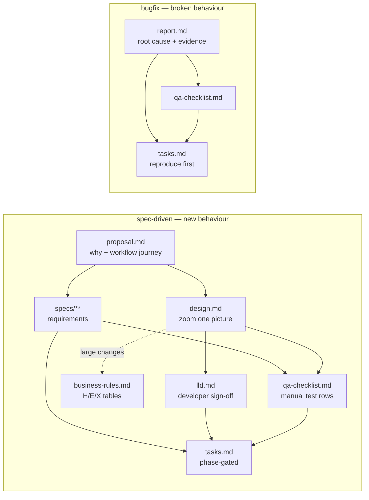

# OpenSpec templates

Two opinionated, stack-neutral workflow schemas for [OpenSpec](https://github.com/Fission-AI/OpenSpec):

- **`spec-driven`**: for building new behaviour. Six artifacts: a business-facing proposal, delta specs, a "zoom one picture" design, a low-level design for developer sign-off, a manual QA checklist and phase-gated tasks.
- **`bugfix`**: for fixing broken behaviour. Three artifacts: an evidence-backed report, a QA checklist and reproduce-first tasks.

They were extracted from a production multi-tenant SaaS codebase, with every stack- and product-specific reference removed. Each project fills in its own details in `openspec/config.yaml` (see [Customise](#customise)).

## The two pipelines



## What makes these templates different

- **Bullets and diagrams, not prose.** Every artifact asks for short bullets, one mermaid diagram per concept, and short table cells.
- **Key concepts first.** The proposal, the design and the bug report all define every domain term before using it.
- **Workflow Journey.** The proposal walks through every user action from start to finish, with ASCII mockups and realistic figures.
- **Zoom one picture.** The design hangs off a single numbered diagram:
  - Part 1 draws it in plain words.
  - Part 2 redraws it with real class and table names.
  - Part 3 has one card per box.
  - Part 4 is reference material.
- **Each design must cover a fixed list of topics.** These include notifications, a query budget (N+1 prevention), 14 architecture patterns, a 12-item security table, and exhaustive edge-case and error-case tables.
- **business-rules.md for large changes.** When the worked examples pass about 30 rows, or span 3 or more test files, they move out of `design.md` into `business-rules.md`. `design.md` then links to it, and the QA checklist and tasks take their IDs from it. Smaller changes keep the tables in `design.md`. This is a rule in the design instruction, not a separate artifact: OpenSpec has no optional artifacts, so making it one would force a file on every change.
- **H/E/X traceability.** Every happy-path (H), edge (E) and error (X) worked example becomes exactly one automated test scenario. Code comments name the IDs they implement, so you can trace from code to ID to test and back.
- **Phase gates.** Each phase ends with a UI review against a named reference screen, an N+1 check and a green test run. The next phase does not start until all three pass.
- **Reproduce first (bugfix).** Phase 1 writes a test that fails against the current code. The report needs a before/after sequence diagram pair and a blast-radius table.

## Install into a project

```bash
# from your project root (OpenSpec CLI already installed and `openspec init` done)
git clone https://github.com/ausangshukla/openspec-templates /tmp/openspec-templates
cp -r /tmp/openspec-templates/openspec/schemas openspec/
cp /tmp/openspec-templates/openspec/config.yaml openspec/config.yaml   # or merge into yours

openspec schemas                          # both schemas should be listed
openspec schema validate spec-driven
openspec schema validate bugfix
```

- Because the project-local `spec-driven` schema has the same name as the built-in one, it replaces it.
- To start a bug fix, run `openspec new change "fix-<what>" --schema bugfix`.
- **Claude Code users:** `/openspec-bugfix` is a slash command. Link it into your skills directory once:

  ```bash
  mkdir -p .claude/skills/openspec-bugfix
  ln -sf ../../../openspec/schemas/bugfix/SKILL.md .claude/skills/openspec-bugfix/SKILL.md
  ```

- The other OpenSpec skills (`/openspec-propose`, `/openspec-apply-change` and so on) come from `openspec init` and work unchanged with these schemas.

## Customise

The schemas never name a specific framework. Wherever they need a project-specific value, they say "the project context". Fill that in under `context:` in [`openspec/config.yaml`](openspec/config.yaml):

| Context item | Used by |
|---|---|
| Acceptance test framework, command, file location, per-run requirements | tasks (phase gates), design › Testing, bugfix tasks |
| N+1 detector | design › Query budget, tasks (N+1 check) |
| Linter, security scanner, dependency audit | design › Security #12, bugfix tasks |
| Module boundaries, operations/services, auth layer, jobs, notifications, front end, LLM wrapper | design › Architecture patterns |
| Reference screens (index, show, tabs, forms) | design › Screen standards, tasks (UI review) |
| Standing project rules | lld › Project Rules Checklist |

These assumptions are built in. Edit the schema if one doesn't fit your project:

- The app is a **multi-tenant web app** with screens. For a single-tenant app or a pure API, drop the tenant-isolation, Screen standards and UI-review items.
- Tests are **acceptance-level scenarios** written Given/When/Then, such as Cucumber, Playwright or pytest-bdd.
- Diagrams are **mermaid**. The design instruction includes a `mermaid-cli` lint command, which needs Node and `npx`.

## Files

| Path | What it is |
|---|---|
| `openspec/config.yaml` | Selects `spec-driven` by default; project context placeholders |
| `openspec/schemas/spec-driven/schema.yaml` | Artifact graph + per-artifact instructions |
| `openspec/schemas/spec-driven/templates/*.md` | proposal, spec, design, lld, qa-checklist, tasks, plus business-rules (large changes only) |
| `openspec/schemas/bugfix/schema.yaml` | Artifact graph + instructions for bug fixes |
| `openspec/schemas/bugfix/templates/*.md` | report, qa-checklist, tasks |
| `openspec/schemas/bugfix/SKILL.md` | `/openspec-bugfix` Claude Code command |
| `openspec/schemas/bugfix/README.md` | bugfix schema notes |

## License

MIT — see [LICENSE](LICENSE).
